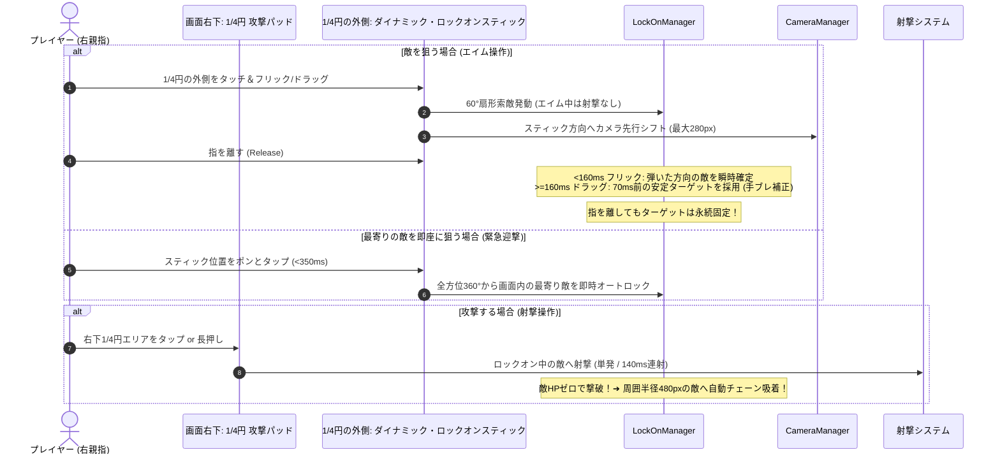

# ツインスティックシューターにおけるスマートロックオン＆タップ射撃設計

モバイルのツインスティックシューターにおいて、画面の物理的な制約（精密エイムの指疲労、画面の狭さ、操作の競合）を解決し、爽快な手触りとタクティカルな判断を両立する「右下 1/4 円攻撃パッド ＋ ダイナミックロックオンスティック ＋ 手ブレ補正 ＆ 撃破チェーン」の最新設計仕様です。

---

## 1. 発生しやすい課題と落とし穴

1. **精密エイムによる指の筋疲労（等尺性収縮）**:
   - スマホのガラス面でスティックを特定の角度に倒し続ける操作は、親指の筋肉が緊張し続け激しく疲労する。
2. **Dynamic スティックとタップ攻撃の競合（誤爆・誤判定）**:
   - 画面右側が Dynamic（タッチ位置にスティック生成）だと、「画面をタップして攻撃したい」ときにスティックが生成されてしまい、攻撃とエイムの判定が衝突する。
3. **指離し（Release）時の手ブレによるターゲットズレ**:
   - 狙った敵に向けてスティックを離す瞬間、指がガラス面から浮き上がる際の微小なスリップで角度が狂い、別の敵や明後日の方向にターゲットが変わってしまう。
4. **無差別オートエイムによる戦略性の欠如**:
   - 「一番近い敵」しか狙えない仕様（ヴァンサバ型）では、前線の肉壁雑魚に弾を吸われ、奥の危険なスナイパーやヒーラーを優先撃破できない。

---

## 2. 解決策：空間分離とスマートロックオンサイクル



---

## 3. コア仕様詳細

### ① 右下 1/4 円の専用攻撃パッド（FIRE）

- **物理エリア**: 画面右下の角 `(width, height)` を中心とする半径 240px の扇形（1/4 円）。
- **操作系**:
  - **タップ**: 単発射撃。
  - **長押し（ホールド）**: 140ms 間隔のフルオート連射。
- **視覚効果**: タッチ中に鮮やかなネオンピンク色にハイライトされ、押下状態を視覚的にフィードバック。

### ② 1/4 円の外側：ダイナミック・ロックオンスティック

- 画面右半分のうち、**右下 1/4 円の攻撃パッドエリアの外側**をタッチすると、その位置に動的（Dynamic）にスティックが出現。
- 攻撃エリアとエイムエリアが物理的に干渉しないため、誤操作なく片手親指でスムーズに切り替え可能。
- スティックのデッドゾーンを超えている間、照準方向を示すインジケーター（矢印）を表示。

### ③ 60° 扇形スマートロックオン ＆ 永続追従

- スティックを倒した方向を中心に、**前方 60°・画面内・射程内**の最も近い敵を自動的に吸着。
- 一度ターゲットを捕捉して指を離すと、以下の条件まで**ターゲットが永続維持**される：
  1. 敵が死亡した（撃破チェーンへ移行）
  2. 再度スティックを操作して別の敵を狙った
  3. 敵が射程限界（`breakDistance: 950px`）または画面外遠方（1000px 超）へ離脱した

### ④ 2 つの直感的なターゲット切り替え（タップ vs フリック）

- **スティックタップ（最寄り即時オートロック）**:
  - デッドゾーン未満のタップ（350ms 未満）で、全方位 360° から画面内の最も近い敵を即座に自動ロック。
  - 背後から接近してきた自爆敵や突進敵への緊急迎撃カウンターに最適。
- **フリック操作（クイック方向指定ロック）**:
  - 160ms 未満の素早い弾き操作で、弾いた方向の敵を瞬時に捕捉・確定。
  - エイムセッション中の新規捕捉ターゲット追跡 ＋ 解放時角度による即時探索フォールバックにより、フレーム落ちや古いターゲットへの引き戻しを完全に防止。

### ⑤ 指離し時の手ブレ補正（70ms タイムバッファ方式）

- 通常ドラッグ操作（>= 160ms）時、画面から指が離れる瞬間の擦れ・ズレを防止。
- 指が離れる **約 70ms 前に安定して狙っていたターゲット** を復元・確定。

### ⑥ 撃破時チェーン連鎖（Chain Targeting）

- ロック中の敵が撃破された瞬間、その爆発地点から **周囲半径 480px 以内の最も近い敵へ即座に自動連鎖**。
- 再度エイムし直すことなく、攻撃パッドを押し続けるだけでテンポよく敵の群れを殲滅可能。

### ⑦ ルックアヘッド・カメラシフト（視界の戦術的非対称性）

- **スティック操作中**: 狙っている方向へカメラが最大 280px 先行シフト。
- **指離し後（交戦中）**: ロック中の敵方向へ適度にシフト。
- **非戦闘時**: 自機中心 `(0, 0)` へスムーズに復帰。
- **ゲームデザイン効果**: 撃っている前方が広く見える反面、**背後に自然な死角（ブラインドスポット）**が生まれ、「壁を背負うポジショニング」や「時折索敵のために撃ちやめる（クリアリング）」というタクティカルな駆け引きが生まれる。

---

## 4. 実装の要点

### 1/4 円攻撃パッドとダイナミックロックオンの境界判定 (`ControllerScene.ts`)

```typescript
// スマホモードにおける画面右半分のタッチ判定
const { width, height } = this.scale;
const distFromCorner = Math.hypot(width - pointer.x, height - pointer.y);

if (distFromCorner <= this.attackPadRadius) {
  // 1/4円の内側: 攻撃パッド発動 (タップ / 長押し連射)
  this.attackPointerIds.add(pointer.id);
  this.drawAttackPadGraphics(true);
  this.notifyGameScene();
} else if (this.lockOnStick.pointerId === null) {
  // 1/4円の外側: ダイナミック・ロックオンスティック出現
  this.activateStick(this.lockOnStick, pointer);
}
```

### フリック即時確定 ＆ 手ブレ巻き戻し補正 (`LockOnManager.ts`)

```typescript
confirmReleaseTarget(
  releaseTime: number,
  touchDuration?: number,
  releaseAngle?: number,
  player?: Phaser.Physics.Arcade.Image,
  enemies?: Phaser.Physics.Arcade.Group,
  scene?: Phaser.Scene,
): void {
  this.isAimingSession = false;

  // 【フリック対応】操作時間が160ms未満の場合
  if (typeof touchDuration === "number" && touchDuration < 160) {
    // 1. フレーム更新の合間で未捕捉だった場合、フリック時の角度で即時探索
    if (this.sessionTargets.length === 0 && typeof releaseAngle === "number" && player && enemies && scene) {
      this.searchAndLock(player, enemies, releaseAngle, scene);
    }
    // 2. セッション中に新しく発見された最初の敵を確実に採用
    for (const target of this.sessionTargets) {
      if (target.active) {
        this.lockedTarget = target;
        this.clearSession();
        return;
      }
    }
    this.clearSession();
    return;
  }

  // 【通常ドラッグ】指が浮き上がる約70ms前の安定したターゲットを探す
  if (this.targetHistory.length > 0) {
    const stableTime = releaseTime - 70;
    let bestEntry: TargetHistoryEntry | null = null;
    let minDiff = Infinity;

    for (const entry of this.targetHistory) {
      if (entry.target.active) {
        const diff = Math.abs(entry.time - stableTime);
        if (diff < minDiff) {
          minDiff = diff;
          bestEntry = entry;
        }
      }
    }

    if (bestEntry && bestEntry.target.active) {
      this.lockedTarget = bestEntry.target;
    }
  }

  this.clearSession();
}
```
