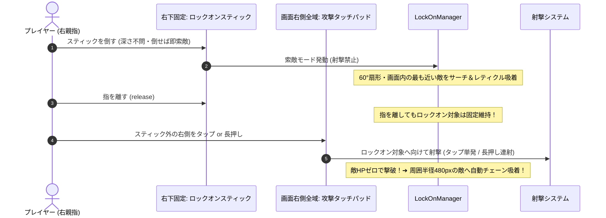

# ツインスティックシューターにおけるスマートロックオン＆タップ射撃設計

モバイルのツインスティックシューターにおいて、画面の物理的な制約（精密エイムの指疲労、画面の狭さ）を解決し、爽快な手触りを生み出す「固定ロックオンスティック ＋ 攻撃タッチパッド ＋ 撃破チェーン」の設計パターンです。

---

## 1. 発生しやすい課題と落とし穴

1. **精密エイムによる指の筋疲労（等尺性収縮）**:
   - スマホのガラス面でスティックを特定の角度に倒し続ける操作は、指の筋肉が緊張し続け激しく疲労する。
2. **Dynamicスティックと画面タップ攻撃の衝突（誤爆・競合）**:
   - 画面右側が Dynamic（タッチ位置にスティック生成）だと、「画面をタップして攻撃したい」ときにスティックが生成されてしまい、攻撃とエイムの判定が競合する。
3. **フルオート連射によるリズム感の欠如**:
   - 押しっぱなしで弾がバラ撒かれると、敵を撃破した手応えやリズミカルな快感が希薄になる。

---

## 2. 解決策：空間分離とスマートロックオンサイクル



### ① 索敵モード（ロックオンスティック倒し中）

- 攻撃スティックは「**LOCK-ON**」スティックへと特化。
- **移動スティックのみDynamic設定（追従）が反映され、ロックオンスティックは常に右下の定位置（Fixed）に固定**。
- スティックの倒し深さに関わらず、アクティブ（デッドゾーン超過）になれば即座に **60°扇形かつ画面内** の最も近い敵をサーチし、ターゲットレティクルを吸着。
- 索敵中は一切弾を発射しないため、エイム中の誤射がゼロになる。

### ② 永続ロックオン（指離し）

- スティックから指を離しても、以下のいずれかが起きるまでターゲットが固定され続ける：
  1. ロック中の敵が死亡した
  2. 再度スティックを倒して索敵モードに入った
  3. 敵が画面外かつプレイヤーから一定距離（1300px）以上離れた

### ③ 攻撃タッチパッド（ロックオンスティック以外の画面右側全域）

- ロックオンスティックの周囲（キャプチャ半径120px）を除く**画面右側の全領域が攻撃トリガーエリア**。
- **タップで単発発射、長押し（ホールド）で自動連射**（140ms間隔）。
- ロックオンスティックを触るか、それ以外の広大な右側を触るかで「エイム」と「攻撃」が完全に空間分離され、誤爆が完全に排除される。

### ④ 撃破時チェーンロックオン（連鎖ターゲット）

- ロック中の敵が撃破された瞬間、その敵の位置から **周囲半径480px以内の最も近い敵へ即座にロックが自動ジャンプ**。
- プレイヤーはスティックを操作し直すことなく、攻撃タッチパッドを叩き続けるだけで敵の群れを一網打尽にできる。

---

## 3. 実装のポイント

### 扇形角度判定

```typescript
const angleToEnemy = Phaser.Math.Angle.Between(player.x, player.y, enemy.x, enemy.y);
const angleDiff = Math.abs(Phaser.Math.Angle.Wrap(angleToEnemy - aimAngle));
const inSector = angleDiff <= Phaser.Math.DegToRad(sectorAngleDeg / 2);
```

### 画面右側の「固定ロックオンスティック」と「攻撃タッチパッド」の判定分離（`ControllerScene.ts`）

```typescript
// 画面右半分がタッチされた場合
const distToLockOn = Math.hypot(
  pointer.x - this.lockOnStick.originX,
  pointer.y - this.lockOnStick.originY,
);
const captureRadius = 120; // ベース半径90pxに対する安全なキャプチャ領域

if (distToLockOn <= captureRadius && this.lockOnStick.pointerId === null) {
  // 定位置のロックオンスティック操作
  this.activateStick(this.lockOnStick, pointer);
} else {
  // スティック外の右側全域: 攻撃発動（タップまたは長押し連射）
  this.attackPointerIds.add(pointer.id);
  this.notifyGameScene();
}
```
