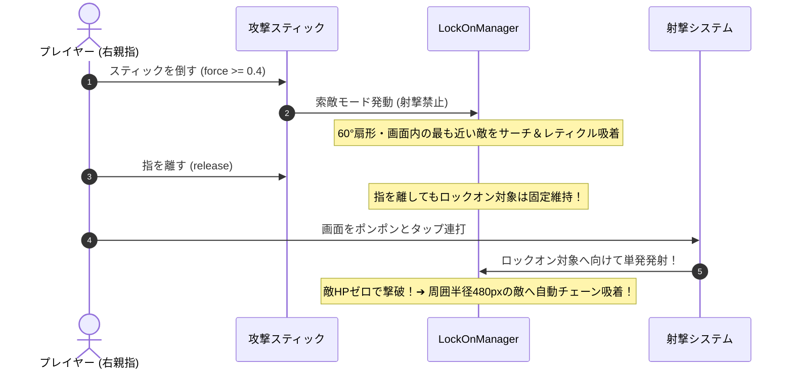

# ツインスティックシューターにおけるスマートロックオン＆タップ射撃設計

モバイルのツインスティックシューターにおいて、画面の物理的な制約（精密エイムの指疲労、画面の狭さ）を解決し、爽快な手触りを生み出す「扇形索敵 ＋ 永続ロックオン ＋ タップ射撃 ＋ 撃破チェーン」の設計パターンです。

---

## 1. 発生しやすい課題と落とし穴

1. **精密エイムによる指の筋疲労（等尺性収縮）**:
   - スマホのガラス面でスティックを特定の角度に倒し続ける操作は、指の筋肉が緊張し続け激しく疲労する。
2. **オートエイムの自由度喪失**:
   - 完全なオートエイムにすると「狙いたい敵を狙えない」「ゲームが退屈になる」問題が発生する。
3. **フルオート連射によるリズム感の欠如**:
   - 押しっぱなしで弾がバラ撒かれると、敵を撃破した手応えやリズミカルな快感が希薄になる。

---

## 2. 解決策：4段階のスマートロックオンサイクル



### ① 索敵モード（スティック倒し中）

- スティックの倒し量がデッドライン（`force >= 0.4`）を超えている間は **索敵モード**。
- スティック方向を中心とする **60°扇形かつ画面内** の最も近い敵をサーチし、ターゲットレティクルを吸着。
- この間は **一切弾を発射しない** ため、無駄撃ちやエイム中の暴発がゼロになる。

### ② 永続ロックオン（指離し）

- スティックから指を離しても、以下のいずれかが起きるまでターゲットが固定され続ける：
  1. ロック中の敵が死亡した
  2. 再度スティックを倒して索敵モードに入った
  3. 敵が画面外かつプレイヤーから一定距離（1300px）以上離れた

### ③ タップ射撃（画面右側タップ連打）

- 浅いホールドでは何も起きず、**画面をタップ（指を置いて離す）するたびに1発発射**。
- 精密な角度維持が不要になり、画面をポンポンとリズミカルに叩くだけでロック対象へ確実に弾が飛ぶ。
- 敵のHPは複数発（例: 3発）必要に設定することで、タップ連打の手応えが強調される。

### ④ 撃破時チェーンロックオン（連鎖ターゲット）

- ロック中の敵が撃破された瞬間、その敵の位置から **周囲半径480px以内の最も近い敵へ即座にロックが自動ジャンプ**。
- プレイヤーはスティックを操作し直すことなく、タップ連打を継続するだけで敵の群れを一網打尽にできる。

---

## 3. 実装のポイント

### 扇形角度判定

```typescript
const angleToEnemy = Phaser.Math.Angle.Between(player.x, player.y, enemy.x, enemy.y);
const angleDiff = Math.abs(Phaser.Math.Angle.Wrap(angleToEnemy - aimAngle));
const inSector = angleDiff <= Phaser.Math.DegToRad(sectorAngleDeg / 2);
```

### スティックのタップ判定（`ControllerScene.ts`）

```typescript
// 1. 倒し量がデッドラインを超えたかを記録
if (force >= 0.4) {
  stick.hasExceededDeadZone = true;
}

// 2. 指を離した時、一度もデッドラインを超えていなければタップ射撃
protected releaseStick(stick: StickVisuals) {
  const isTapShoot = stick === this.shootStick && !stick.hasExceededDeadZone;
  // ...
  if (isTapShoot) {
    gameScene.events.emit("controller-tap-shoot");
  }
}
```
